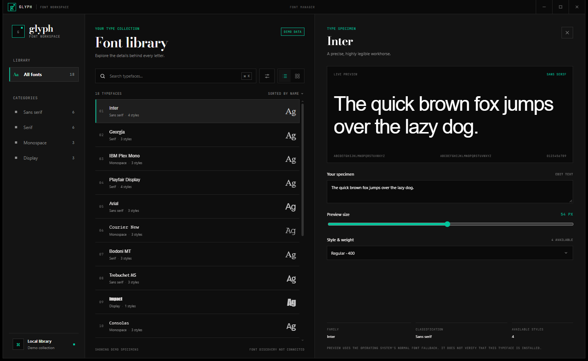

# Glyph

**A desktop workspace for exploring typefaces.** Glyph is an early Electron prototype with an editorial specimen interface and a custom desktop window frame.

<p align="center">
  
</p>

> [!IMPORTANT]
> **Prototype status:** Glyph discovers registered Windows font files and reads individual face metadata (family, face name, weight, width, style, file path/size, character mappings, and version where exposed). Results are cached locally with a manual rescan control. macOS and Linux discovery, multi-face TTC/OTC indexing, variable-font axes, OpenType controls, and font installation/activation are not implemented. Windows is the only platform on which the app has been run and checked so far.

## What works today

- Discover and search Windows-installed font families, with their individual registered font faces and file metadata.
- Inspect a specimen, edit its sample text, and adjust preview size.
- Select an actual installed face and inspect its file path, format, size, weight, width, style, glyph count, and version.
- Use explicit empty-search and no-selection states.
- Resize a frameless desktop window and use minimize, maximize/restore, and close controls.
- Render the interface with bundled Bodoni Moda and JetBrains Mono variable fonts.

The Windows catalogue is built from the per-user and machine font registry, then parses registered TTF/OTF/TTC/OTC files through WPF's `GlyphTypeface`. The specimen uses the selected installed family and face weight/style. Multi-face collection indexing, variable axes, detailed OpenType features, and shaping are not implemented. Persian sample text is not evidence of shaping or glyph coverage.

## Development status

| Area | Current status |
| --- | --- |
| Desktop UI and custom window frame | Implemented prototype |
| Windows installed-font discovery | Implemented (registered files and face metadata) |
| macOS and Linux installed-font discovery | Planned; not in the app |
| Detailed font metadata and face/variant inventory | Partial; TTC/OTC collection indexing and advanced metadata not implemented |
| Accurate shaping, OpenType features, and variable axes | Planned; not in the app |
| Large-catalogue search | Planned; no production catalogue yet |
| Windows | Verified on Windows 10 Pro x64 according to the development run recorded on 2026-11-15 |
| macOS and Linux | Unverified |

The separate Python feasibility study provides Windows research evidence for font discovery, metadata parsing, HarfBuzz shaping, FreeType raster previews, and SQLite FTS5 search. It is not part of the Electron app and does not demonstrate a production backend or Rust/Tauri integration. Read [the Windows font research report](docs/research/windows-font-spike.md) for methods, measurements, and limitations.

## Technology

- Electron 45 with Electron Forge 8 and the Vite plugin
- React 19 and TypeScript 6
- Vite 8
- Oxlint and Oxfmt
- npm with the committed `app/package-lock.json`

## Requirements

- Node.js 22 or newer
- npm (bundled with Node.js)
- A supported desktop environment for Electron

Windows is the only environment verified so far. macOS and Linux are intended targets, but their development and packaging workflows still need validation.

## Run locally

Run these commands from `app/`:

```powershell
npm ci
npm start
```

Electron 45 ships its runtime as a separate binary. If Forge cannot fetch it automatically on first launch, run this once from `app/`, then start again:

```powershell
npm exec -- install-electron
npm start
```

## Useful checks and packaging

From `app/`:

```powershell
npm run typecheck
npm run lint
npm run package
```

`npm run lint` runs Oxlint. The CI workflow runs Oxfmt's formatting check on Ubuntu, where line-ending behavior is consistent across checkouts; the Windows runner still runs lint and packaging checks without failing on platform-specific line endings.

`npm run package` creates an unpacked application under `app/out/` for the current host. `npm run make` creates distributables for the current host using Electron Forge:

- Windows: Squirrel installer (`Setup.exe`) plus its `.nupkg` package and `RELEASES` update manifest.
- macOS: ZIP archive.
- Linux: DEB and RPM packages.

The Windows x64 installer was successfully generated locally for Glyph 1.0.0. The application has only been run and verified on Windows; macOS and Linux packages are build targets, not evidence of working font discovery or verified runtime support on those systems.

### GitHub Releases

The `.github/workflows/release.yml` workflow builds distributables on Windows, macOS, and Linux and publishes their files with a SHA-256 checksum manifest to a GitHub Release whenever a version tag matching `v*` is pushed. The tag should match the version in `app/package.json` (currently `v1.0.0`).

After pushing the repository to GitHub, create and push a version tag to start the release:

```bash
git tag v1.0.0
git push origin v1.0.0
```

The workflow requires GitHub Actions to be enabled and the repository's Actions token to have permission to create releases. It does not run for ordinary pushes to `main`. Review the generated draft-free GitHub Release and its assets after the workflow completes. Do not push a tag until the matching version and source commit are ready to distribute.

## Security model

The Electron renderer runs with Node integration disabled, context isolation enabled, sandboxing enabled, and web security enabled. A restrictive content security policy is configured for the renderer. The preload exposes a small typed window-control API through `contextBridge`; it does not expose `ipcRenderer` or general Electron access. Main-process handlers validate the sending window, require its main frame, and reject unexpected arguments. The app denies renderer navigation and new window creation.

This is the prototype's current security baseline, not a claim that the application has undergone a security audit. Future font parsing and preview work should isolate untrusted font data in a constrained worker process with resource limits.

## Roadmap

1. **Real catalogue:** discover installed fonts through native platform providers and reconcile family, face, style, and file identity.
2. **Metadata and variants:** parse real names, weights, widths, variable axes, named instances, and relevant OpenType tables.
3. **Accurate specimens:** implement shaping, script-aware fallback, real OpenType feature controls, and variable-axis rendering.
4. **Scale:** measure and improve indexing, filtering, and search against large real-world catalogues.
5. **Cross-platform support:** implement and verify native discovery, packaging, and runtime behavior on Windows, macOS, and Linux.

The Python spike's proposed Rust libraries are research directions only. The application currently uses Electron and TypeScript; no Rust/Tauri integration is present.

## Repository guide

```text
app/                  Electron, React, and TypeScript application
  src/                Main, preload, renderer, UI, and bundled font assets
  DESIGN.md           Obsidian Gazette design system
docs/
  images/             Curated project screenshots
  research/           Feasibility studies, separate from app implementation
third_party/fonts/    Upstream font license notices
font_spike.py         Windows-only Python feasibility study
test_spike.py         Tests for the feasibility study (not app tests)
requirements.txt      Python spike dependencies
```

See [the app-specific guide](app/README.md), [the design system](app/DESIGN.md), [the research report](docs/research/windows-font-spike.md), and [bundled font notices](docs/FONTS.md).

## Contributing

Contributions are welcome. Start with [CONTRIBUTING.md](CONTRIBUTING.md), follow the [Code of Conduct](CODE_OF_CONDUCT.md), and check the issue tracker once this repository is hosted on GitHub. Keep prototype limitations and platform verification status accurate in documentation and pull requests.

## Support and security

- For bugs and feature proposals, use the repository's GitHub issue tracker after it is hosted on GitHub.
- For a suspected security vulnerability, use GitHub's **Report a vulnerability** flow in the repository's Security tab when private vulnerability reporting is enabled. Do not disclose exploitable details in a public issue.
- For abuse or conduct concerns on GitHub, use [GitHub's reporting and support channels](https://support.github.com/contact/report-abuse).

## License

The Glyph project code is licensed under the [MIT License](LICENSE). Bundled font files are separate third-party works distributed under their own SIL Open Font License 1.1 terms; see [`third_party/fonts/`](third_party/fonts/) for the notices. The project license does not replace or relicense those fonts.

## Acknowledgments

Glyph bundles **Bodoni Moda** by the Bodoni Moda Project Authors and **JetBrains Mono** by the JetBrains Mono Project Authors. Their upstream projects and license notices are linked in [`docs/FONTS.md`](docs/FONTS.md).
